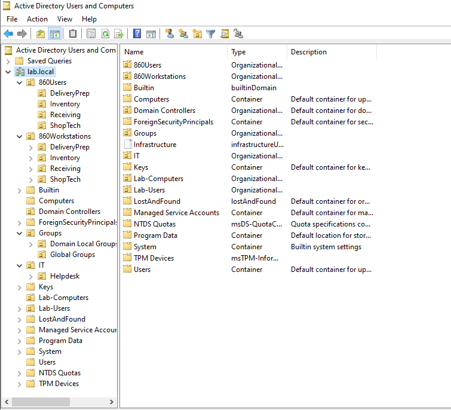
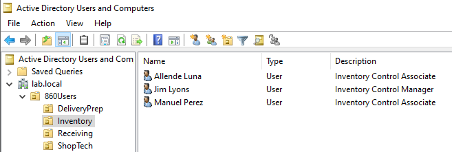
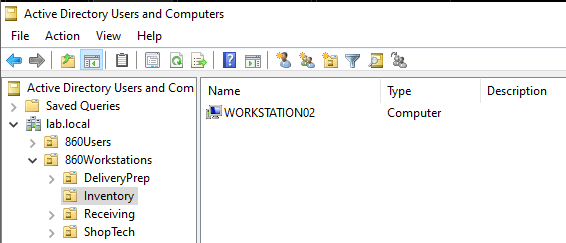
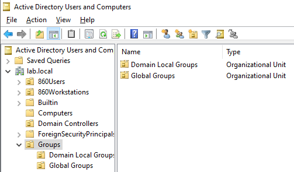

# Project 1 - OU Design & Domain Structure

## Overview

Designed and implemented a departmental Active Directory Organizational Unit (OU) structure within `lab.local` to simulate a warehouse and service-based business environment. The structure was built to support administrative organization, targeted Group Policy deployment, delegated administration, departmental separation, Role-Based Access Control (RBAC), and future scalability.

## Active Directory Hierarchy

```text
lab.local
├── 860Users
│   ├── DeliveryPrep
│   ├── Inventory
│   ├── Receiving
│   └── ShopTech
│
├── 860Workstations
│   ├── DeliveryPrep
│   ├── Inventory
│   ├── Receiving
│   └── ShopTech
│
├── Groups
│   ├── Global Groups
│   │   ├── GG_Inventory_Users
│   │   ├── GG_860Managers
│   │   └── GG_Helpdesk
│   │
│   └── Domain Local Groups
│       └── DL_Inventory_Share_RW
│
└── IT
    └── Helpdesk
```

## Design Objectives

- Create a logical departmental hierarchy separating user and computer objects.
- Establish clear boundaries for targeted Group Policy Object (GPO) linking and inheritance.
- Support future delegation of administrative responsibilities through dedicated administrative OUs.
- Implement AGDLP-aligned security group organization to support scalable RBAC.
- Create a scalable Active Directory design that can accommodate future departments, resources, and administrative roles.

## Implementation Highlights

- Created separate OU structures for users and workstations.
- Built department-specific child OUs for Inventory, Receiving, ShopTech, and DeliveryPrep.
- Created a dedicated IT OU to support delegated administration scenarios.
- Implemented separate Global Group and Domain Local Group containers to support AGDLP-based access management.
- Structured the environment to support future growth without requiring OU redesign.

## Validation

Verified that:

- Department users are located within their appropriate OUs.
- Workstations are separated from user objects.
- GPOs can be linked and targeted at both parent and child OU levels.
- Security Filtering and Delegation of Control can be applied at the departmental level.
- The OU and group structure supports AGDLP-based access management.

## Business Value

The Organizational Unit (OU) structure provides a scalable foundation for Active Directory administration by separating users, workstations, departments, and administrative functions into logical management boundaries.

This design supports:

- **Granular Policy Enforcement** through targeted user and computer GPO deployment.
- **Delegation Readiness** by isolating administrative functions and departmental boundaries.
- **Role-Based Access Control (RBAC)** through structured security group placement.
- **Centralized Administration** of users, computers, and policies.
- **Enterprise Scalability** by supporting future departments, permission models, and administrative roles without requiring significant restructuring.

## Exhibits

### Exhibit 1: Full Active Directory OU Structure



High-level view of `lab.local` in Active Directory Users and Computers (ADUC), showing the overall OU hierarchy and departmental organization.

### Exhibit 2: 860Users Hierarchy & User Objects



Detailed view of the `860Users` hierarchy showing departmental user organization for targeted policy application and administrative management.

### Exhibit 3: 860Workstations Hierarchy



Detailed view of the `860Workstations` hierarchy showing computer objects separated from user accounts to support independent computer-side Group Policy administration.

### Exhibit 4: Groups OU Hierarchy



View of the `Groups` OU showing separate Global Group and Domain Local Group containers to support RBAC and AGDLP-based access management.