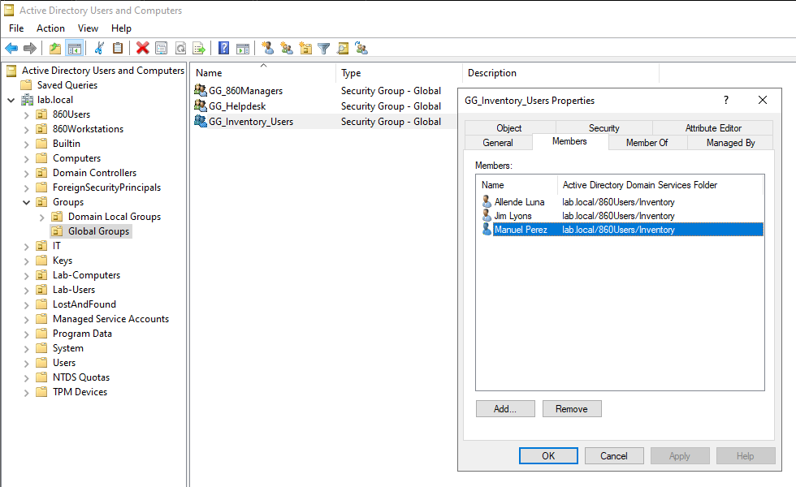
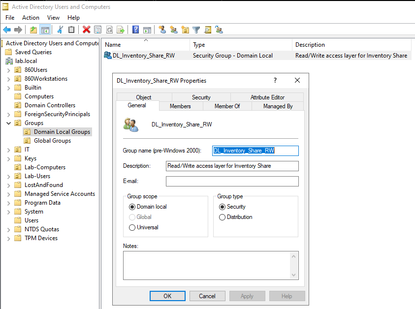
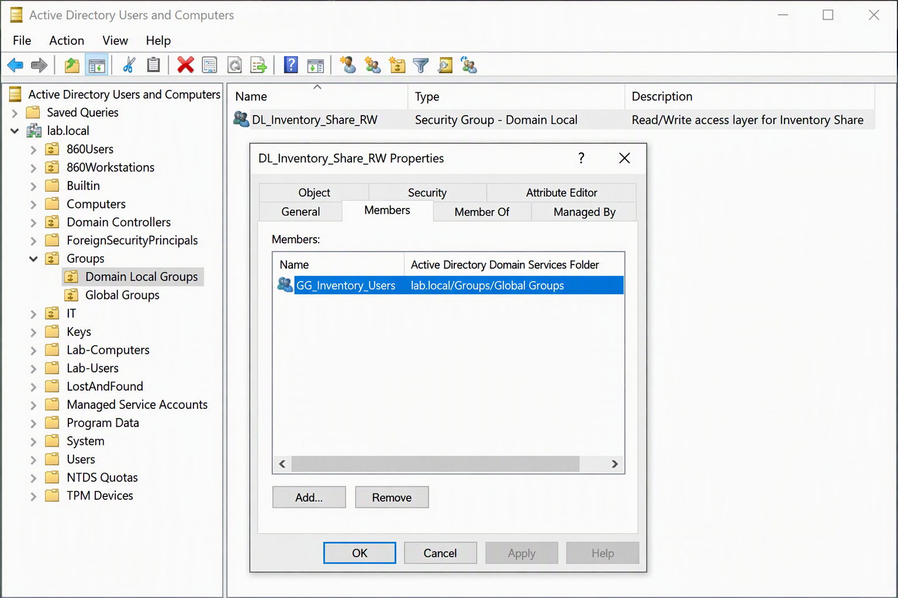
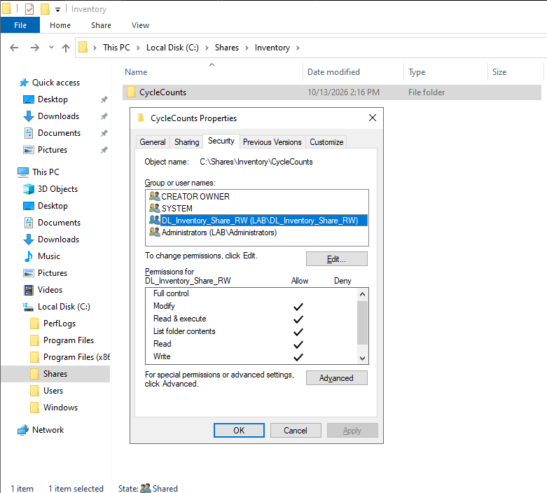
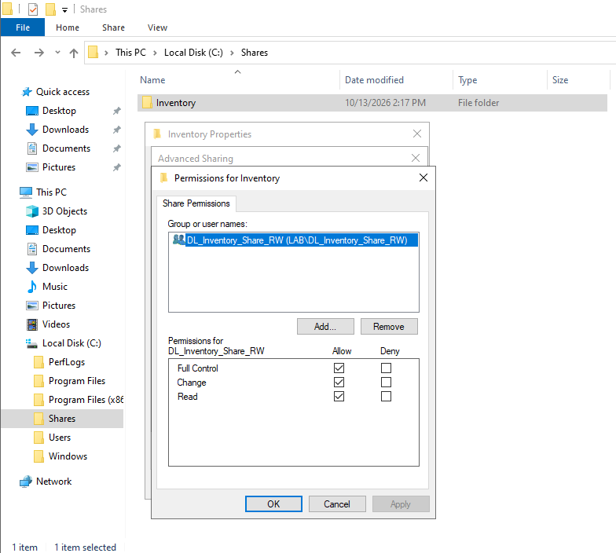
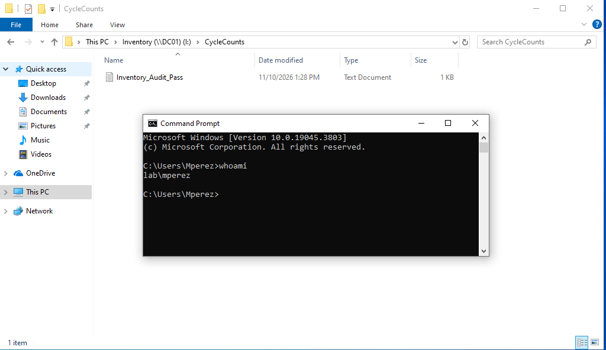
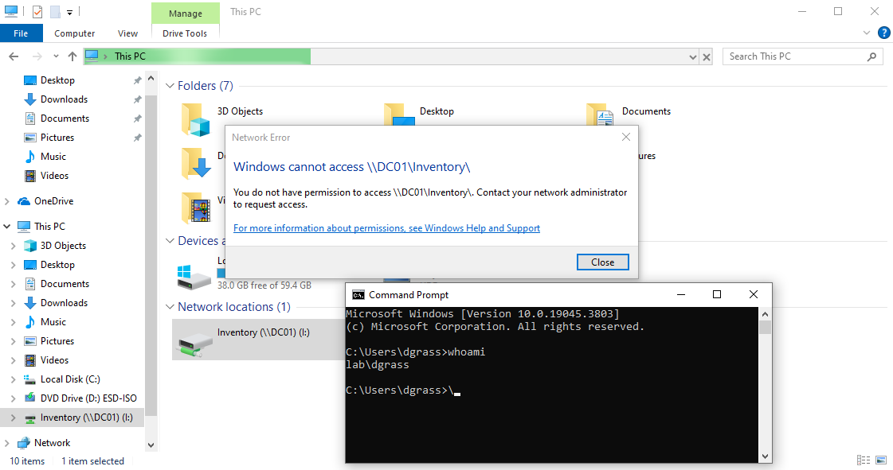

# Project 2 - AGDLP Access Model

## Overview

Implemented the AGDLP (Accounts → Global Groups → Domain Local Groups → Permissions) access control model to manage access to the Inventory department file share. The solution demonstrates Role-Based Access Control (RBAC), centralized permission management, and least-privilege design while simplifying onboarding and offboarding operations.

## Access Flow

```text
User
  ↓
GG_Inventory_Users
  ↓
DL_Inventory_Share_RW
  ↓
Inventory Share
```

## Objectives

- Implement the AGDLP access control model.
- Centralize permission management through security groups.
- Support Role-Based Access Control (RBAC).
- Simplify onboarding and offboarding processes.
- Avoid assigning permissions directly to user accounts.

## Implementation Highlights

- Created a Global Security Group (`GG_Inventory_Users`) to represent Inventory department personnel.
- Created a Domain Local Security Group (`DL_Inventory_Share_RW`) to serve as the permission-assignment layer.
- Nested the Global Group into the Domain Local Group following AGDLP principles:
  - `GG_Inventory_Users` → `DL_Inventory_Share_RW`
- Assigned share and NTFS permissions to the Domain Local Group rather than directly to users.
- Configured Inventory users to inherit access through group membership.

## Validation

Verified that:

- Inventory users receive access through group membership.
- Permissions are assigned to groups rather than individual users.
- Removing a user from the Global Group removes access to the resource.
- AGDLP nesting functions correctly.
- Access management can be performed without modifying resource permissions.

## Business Value

The AGDLP model reduces administrative overhead by allowing access changes to be managed through group membership rather than directly modifying permissions on resources.

This approach supports:

- **Least Privilege**
- **Role-Based Access Control**
- **Scalability**
- **Simplified Access Reviews**
- **Simplified Onboarding and Offboarding**

## Exhibits

### Exhibit 1: Global Security Group Configuration



Global Security Group (`GG_Inventory_Users`) created to represent the Inventory department role.

### Exhibit 2: Domain Local Group Configuration



Domain Local Security Group (`DL_Inventory_Share_RW`) created to manage access permissions for the Inventory department file share.

### Exhibit 3: AGDLP Group Nesting Structure



Global Security Group (`GG_Inventory_Users`) nested within the Domain Local Security Group (`DL_Inventory_Share_RW`) to implement the AGDLP access model.

### Exhibit 4: Inventory NTFS Permissions



NTFS permissions assigned to `DL_Inventory_Share_RW` rather than individual user accounts, supporting centralized permission management.

### Exhibit 5: Inventory Share Permissions



Share permissions assigned to `DL_Inventory_Share_RW` for the Inventory share (`\\DC01\Inventory`), replacing the default permission configuration.

### Exhibit 6: Authorized Access Validation



Validation showing Inventory user `lab\mperez` successfully accessing and creating files within the Inventory share.

### Exhibit 7: Unauthorized Access Validation



Validation showing unauthorized user `lab\dgrass` denied access to the Inventory share, confirming proper permission enforcement.