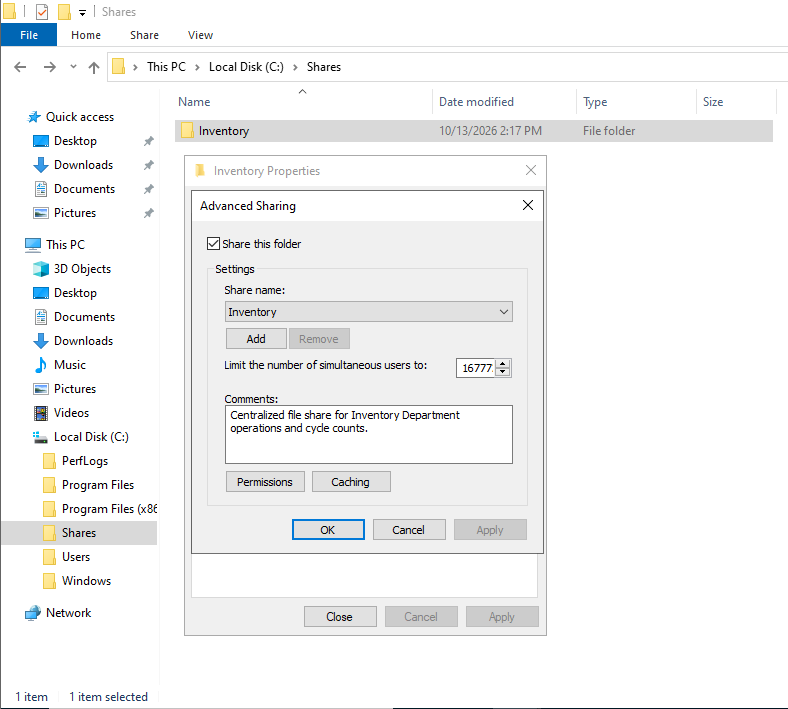
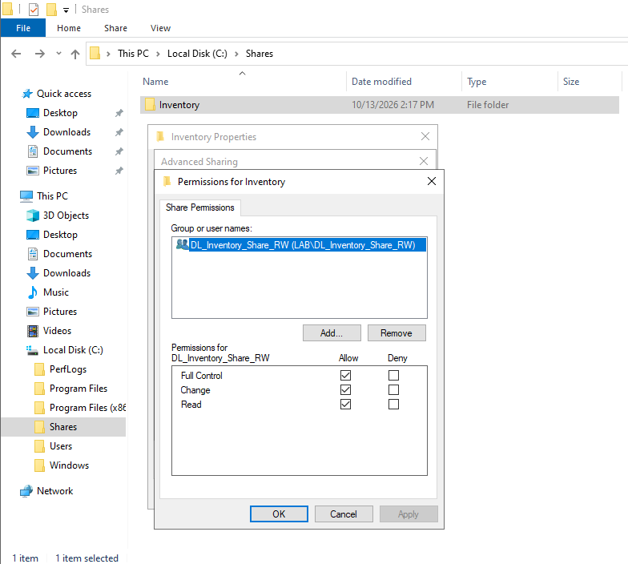
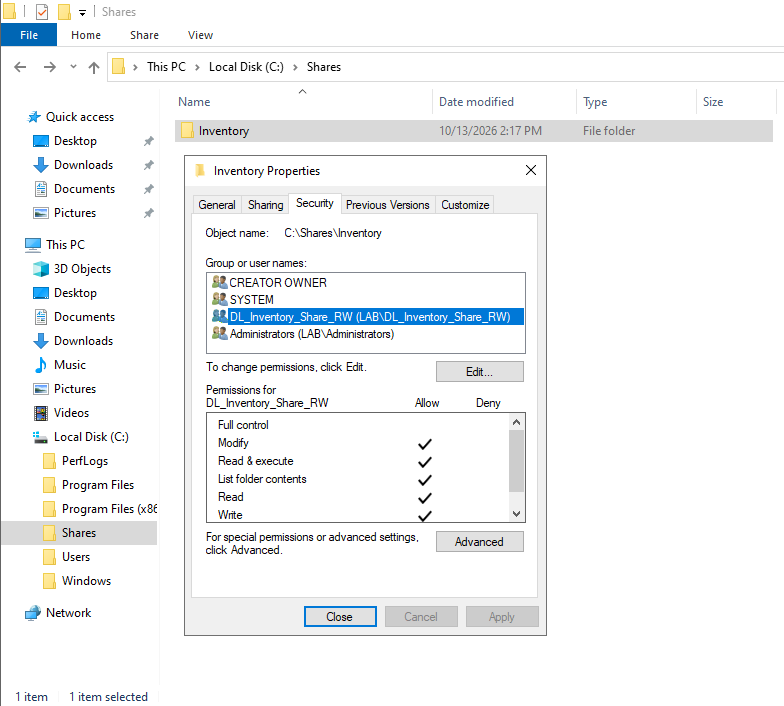
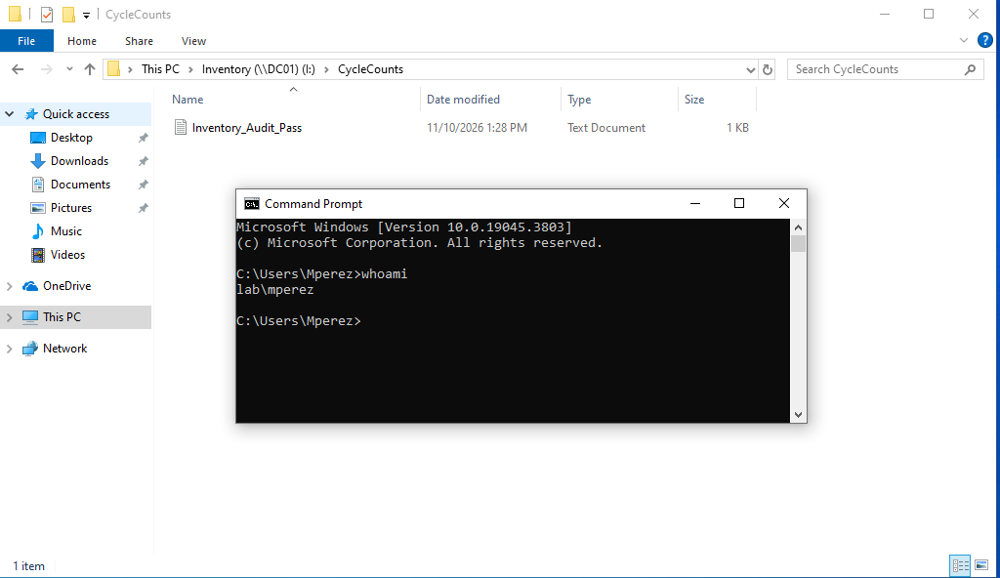
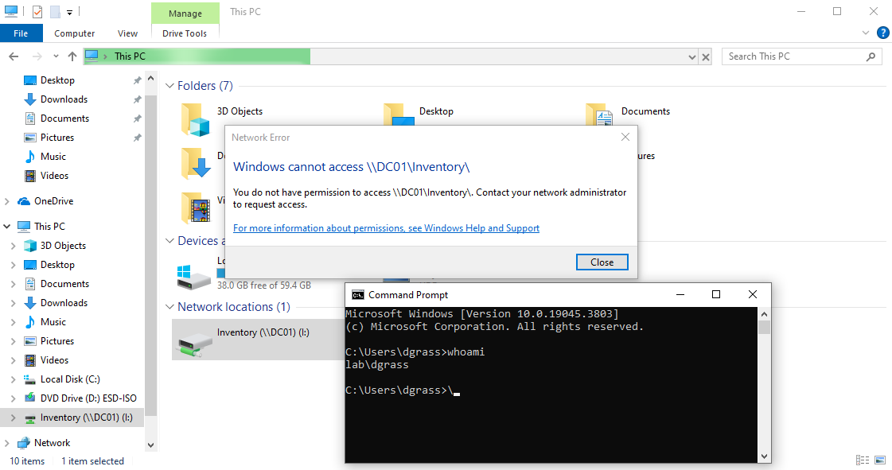

# Project 3 - Department File Share

## Overview

Designed and implemented a departmental file share for the Inventory department to provide centralized storage and controlled access to business resources. Access was secured using NTFS permissions, Share permissions, and the AGDLP access model developed in Project 2.

## Resource Architecture

```text
Inventory Users
      ↓
GG_Inventory_Users
      ↓
DL_Inventory_Share_RW
      ↓
Inventory Share
```

## Objectives

- Create a centralized departmental file share.
- Implement secure access controls.
- Restrict unauthorized access.
- Utilize AGDLP for permission management.
- Simulate enterprise file server administration.

## Implementation Highlights

- Created the Inventory folder on the file server.
- Configured the Inventory network share.
- Assigned Share permissions to `DL_Inventory_Share_RW`.
- Assigned NTFS Modify permissions to `DL_Inventory_Share_RW`.
- Implemented access inheritance through AGDLP group nesting.
- Validated both authorized and unauthorized access scenarios.

## Validation

Verified that:

- Inventory users can access the Inventory share.
- Inventory users can create, modify, and delete files.
- Non-Inventory users are denied access.
- Direct user permissions were not required.
- Access is granted and revoked through group membership.

## Business Value

Centralizing access through security groups improves security, consistency, and scalability by ensuring permissions are managed through role membership rather than direct user assignments.

This approach supports:

- **Least Privilege**
- **Centralized Access Management**
- **Simplified Auditing**
- **Simplified User Provisioning**
- **Simplified User Deprovisioning**

## Exhibits

### Exhibit 1: Inventory Network Share Configuration



Configuration of the Inventory departmental file share (`\\DC01\Inventory`) hosted on the file server.

### Exhibit 2: Inventory Share Permissions



Share permissions assigned to `DL_Inventory_Share_RW`, with default `Everyone` access removed.

### Exhibit 3: Inventory NTFS Permissions



NTFS permissions assigned to `DL_Inventory_Share_RW` to control access to Inventory department files and folders.

### Exhibit 4: Authorized Access Validation



Validation showing authorized Inventory user `lab\mperez` successfully accessing and creating files within the Inventory share.

### Exhibit 5: Unauthorized Access Validation (Least Privilege)



Validation showing unauthorized user `lab\dgrass` denied access to the Inventory share, confirming proper permission enforcement.