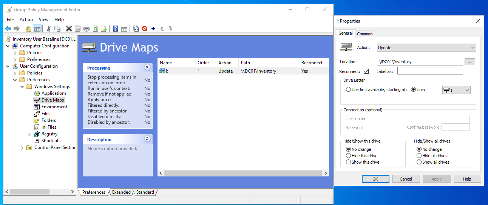
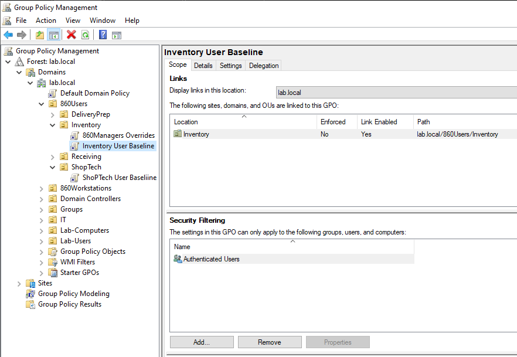
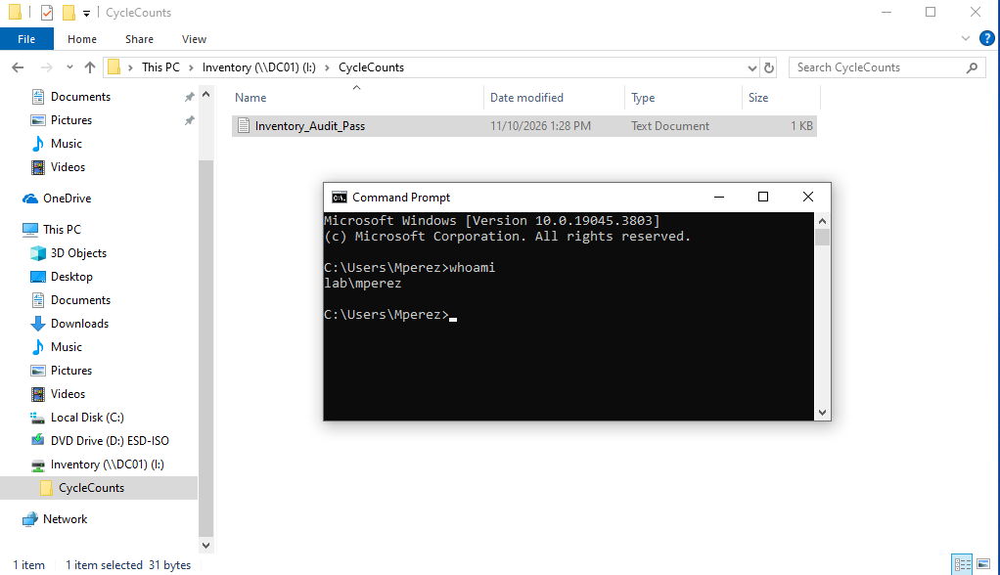
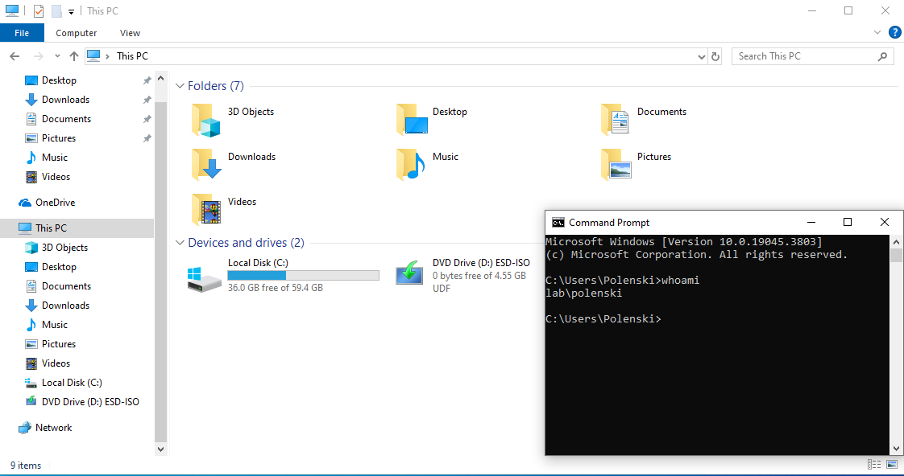

# Project 4 - Drive Mapping via Group Policy

## Overview

Implemented centralized drive mapping through Group Policy Preferences to automatically deploy the Inventory department file share to users within the targeted Organizational Unit upon login.

The solution eliminates manual drive mapping while ensuring only authorized users receive access to the mapped resource.

## Access Flow

```text
Inventory OU → Inventory User Baseline GPO → I: Drive → Inventory Share
```

## Objectives

- Automate drive mapping for Inventory users.
- Provide consistent access to departmental resources.
- Eliminate manual drive configuration.
- Support centralized access management.
- Integrate GPO deployment with AGDLP access controls.

## Implementation Highlights

- Configured drive mapping through the `Inventory User Baseline` GPO.
- Linked the GPO to the Inventory OU.
- Configured the mapped drive:

```text
Drive Letter: I:
Location: \\DC01\Inventory
```

- Utilized OU-based targeting to automatically deploy the `I:` drive to Inventory users.
- Validated drive deployment through user logon.

## Validation

Verified that:

- Inventory users automatically receive the `I:` drive.
- Inventory users can access the Inventory share through the mapped drive.
- Users within departments without the drive mapping GPO do not receive the `I:` drive.
- Drive mapping persists across user logins.
- Drive mappings are deployed centrally without requiring individual workstation configuration.

## Business Value

Automated drive mapping reduces administrative effort by centralizing resource delivery through Group Policy rather than requiring manual configuration on individual workstations.

This approach supports:

- **Consistent User Experience**
- **Centralized Administration**
- **Reduced Support Overhead**
- **Simplified Onboarding**
- **Scalable Department Resource Deployment**

## Exhibits

### Exhibit 1: Drive Mapping GPO Configuration



Group Policy Preference configured to automatically map the Inventory share (`\\DC01\Inventory`) as drive `I:`.

### Exhibit 2: GPMC GPO Link and OU Scope



Group Policy Management Console displaying the `Inventory User Baseline` GPO linked to the Inventory Organizational Unit for automatic drive deployment.

### Exhibit 3: Inventory User Drive Mapping Validation



Validation showing Inventory user `lab\mperez` automatically receiving the Inventory drive mapping (`I:`).

### Exhibit 4: Non-Targeted User Validation



Validation showing non-Inventory user `lab\polenski` does not receive the `I:` drive mapping because the GPO is not linked to the user's OU.