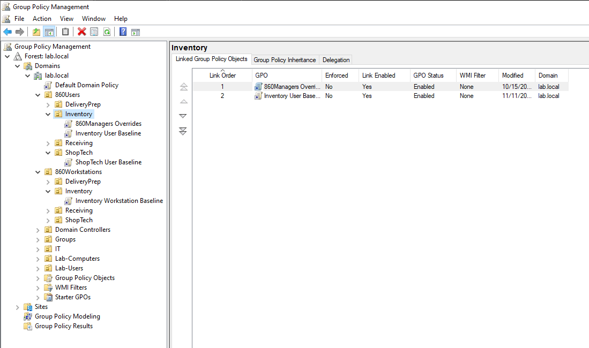
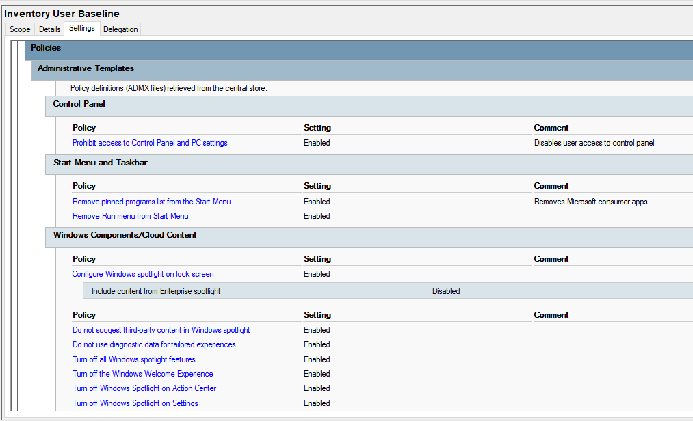
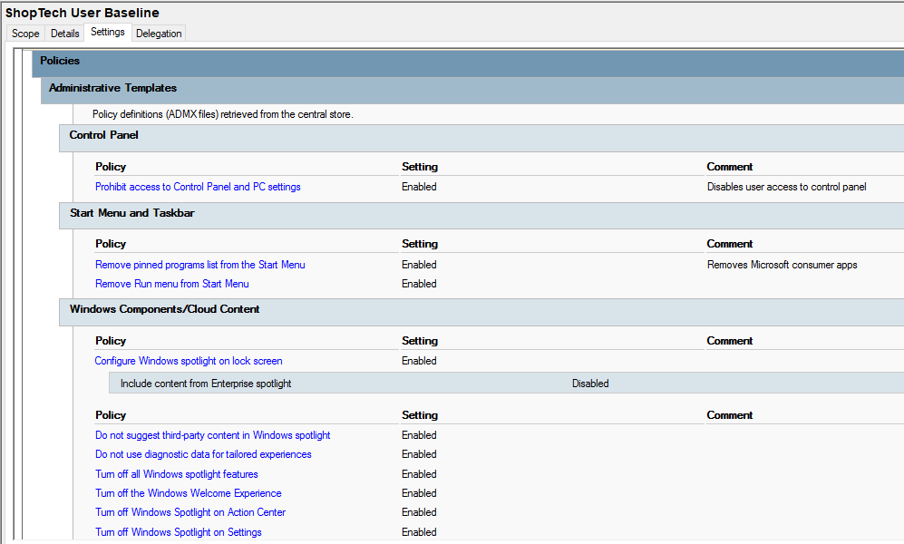
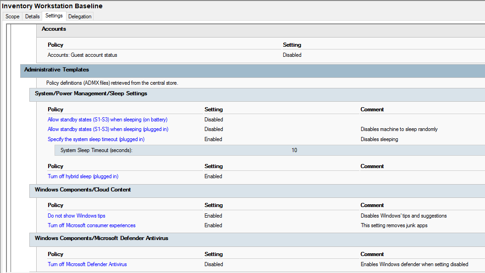

# Project 5 - Group Policy Administration

## Overview

Implemented multiple Group Policy Objects (GPOs) to centrally manage user and workstation configurations across departmental Organizational Units (OUs). Policies were designed to enforce security baselines, standardize workstation configurations, and support role-based administration through Active Directory.

## GPO Structure

```text
860Users
├── Inventory
│   └── Inventory User Baseline
│
└── ShopTech
    └── ShopTech User Baseline

860Workstations
└── Inventory
    └── Inventory Workstation Baseline
```

## Objectives

- Centralize workstation and user configuration management.
- Implement departmental security baselines.
- Reduce manual workstation configuration.
- Support role-based policy deployment.
- Establish a foundation for future policy exceptions and security filtering.

## Implementation Highlights

- Created user and workstation-specific Group Policy Objects.
- Linked GPOs to the appropriate Organizational Units.
- Configured department-specific policy settings.
- Implemented separate user and computer policy management.
- Established parent and child OU policy scoping.
- Validated policy inheritance and application across departments.

### Configured GPOs

- `Inventory User Baseline`
- `Inventory Workstation Baseline`
- `ShopTech User Baseline`

### Policy Categories Implemented

- User Restrictions
- Desktop Configuration
- Start Menu Configuration
- Windows Feature Restrictions
- Workstation Configuration
- Department-Specific Settings

## Validation

Verified that:

- GPOs apply successfully to targeted users and computers.
- User policies process correctly at logon.
- Computer policies process correctly during startup.
- Department-specific users receive the appropriate configurations.
- Workstation policies are isolated from user policies where required.
- Policy settings can be updated centrally without modifying individual endpoints.

## Business Value

Centralized policy management reduces administrative effort by allowing workstation and user configurations to be managed from Active Directory rather than individually on each device.

This approach supports:

- **Standardization**
- **Security Enforcement**
- **Centralized Administration**
- **Reduced Configuration Drift**
- **Simplified Troubleshooting**
- **Scalable Workstation Management**

## Exhibits

### Exhibit 1: GPMC Organizational Unit and GPO Hierarchy



Group Policy Management Console showing departmental Organizational Units and their associated baseline Group Policy Objects.

### Exhibit 2: Inventory User Baseline Policy Settings



Group Policy Management Console Settings report detailing User Configuration policies enforced on the Inventory department, including Control Panel restrictions, Start Menu standardization, and Cloud Content controls.

### Exhibit 3: ShopTech User Baseline Policy Settings



Group Policy Management Console Settings report confirming standardized User Configuration restrictions applied to the ShopTech Organizational Unit.

### Exhibit 4: Inventory Workstation Baseline Policy Settings



Group Policy Management Console Settings report showing Computer Configuration policies enforced on Inventory workstations, including Guest account disablement, power state controls, and Microsoft Defender Antivirus enforcement. 