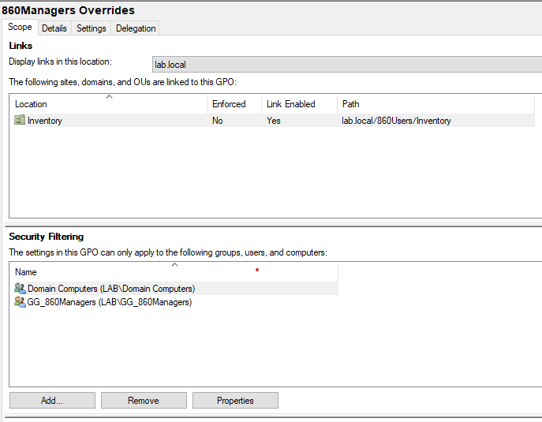
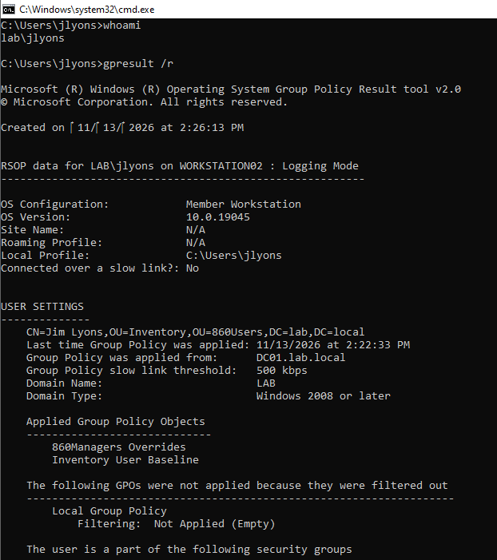
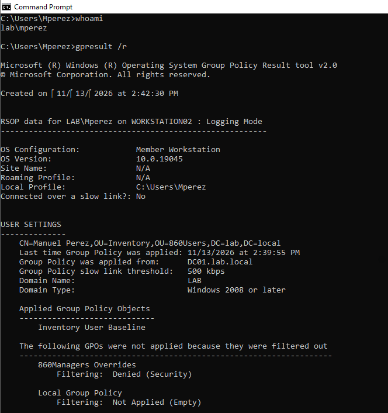

# Project 6 - Security Filtering & Manager Exemptions

## Overview

Implemented Group Policy Security Filtering to provide role-based policy exceptions within the Inventory department. The solution was designed to exempt managers from standard departmental restrictions while maintaining baseline controls for regular users.

This project demonstrates advanced Group Policy targeting through Security Filtering, GPO precedence, and security group membership.

## Architecture / Policy Flow

```text
Inventory OU
├── Inventory User Baseline
└── 860Managers Overrides
          ↓
   Security Filtering
          ↓
    GG_860Managers
          ↓
     Manager Users
```

## Objectives

- Implement Group Policy Security Filtering.
- Create role-based policy exceptions without modifying OU structure.
- Maintain department security standards while supporting management requirements.
- Demonstrate least-privilege administration principles.
- Reduce administrative overhead associated with managing policy exceptions.

## Implementation Highlights

- Created a manager-specific security group: `GG_860Managers`.
- Created a dedicated override GPO: `860Managers Overrides`.
- Configured Security Filtering to target members of `GG_860Managers`.
- Removed `Authenticated Users` from Security Filtering.
- Added `Domain Computers` with Read permissions to support user GPO processing.
- Configured GPO precedence so `860Managers Overrides` takes priority when its settings conflict with the baseline.
- Verified that policy exceptions are controlled through security group membership rather than additional OU placement.

## Validation

Verified that:

- Standard Inventory users receive baseline restrictions.
- Managers receive override settings through security group membership.
- Security Filtering successfully targets only designated users.
- GPO precedence correctly resolves conflicting settings.
- No OU restructuring is required to support policy exceptions.
- Policy exceptions can be managed through group membership.

## Business Value

Security Filtering enables targeted policy deployment without increasing OU complexity.

This approach supports:

- **Role-Based Access Control (RBAC)**
- **Least Privilege Administration**
- **Simplified Policy Management**
- **Reduced Administrative Overhead**
- **Manager-Specific Exceptions**
- **Scalable Policy Deployment**

The design allows organizations to manage policy exceptions through group membership rather than creating additional OUs or duplicating policy structures.

## Exhibits

### Exhibit 1: Inventory OU Link Order and GPO Precedence


GPMC showing `860Managers Overrides` at a higher link precedence than `Inventory User Baseline`, ensuring conflicting manager-specific settings take precedence over standard department restrictions.

### Exhibit 2: Security Filtering Configuration



Security Filtering configured for `860Managers Overrides`, targeting `GG_860Managers` while retaining `Domain Computers` within the filtering configuration.

### Exhibit 3: GG_860Managers Membership


Membership of `GG_860Managers`, identifying the accounts eligible for manager-specific policy exceptions where the override GPO is in scope.

### Exhibit 4: Manager Exception Validation and Precedence



`gpresult /r` output confirming that manager account `lab\jlyons` received both `860Managers Overrides` and `Inventory User Baseline`, validating manager-specific policy application.

### Exhibit 5: Standard Inventory User Restriction Validation



`gpresult /r` output confirming that standard Inventory user `lab\mperez` received `Inventory User Baseline` while `860Managers Overrides` was filtered out with `Denied (Security)`, validating Security Filtering for non-manager users.