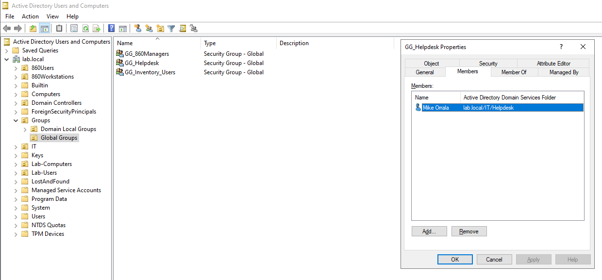
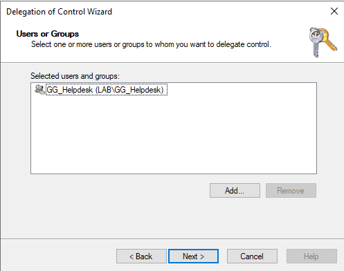
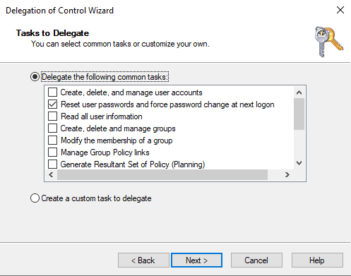
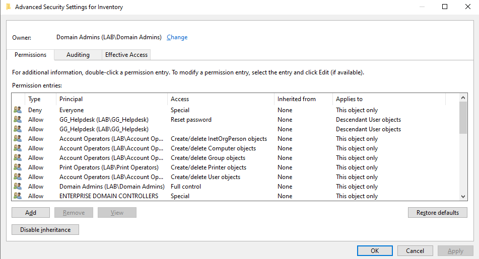
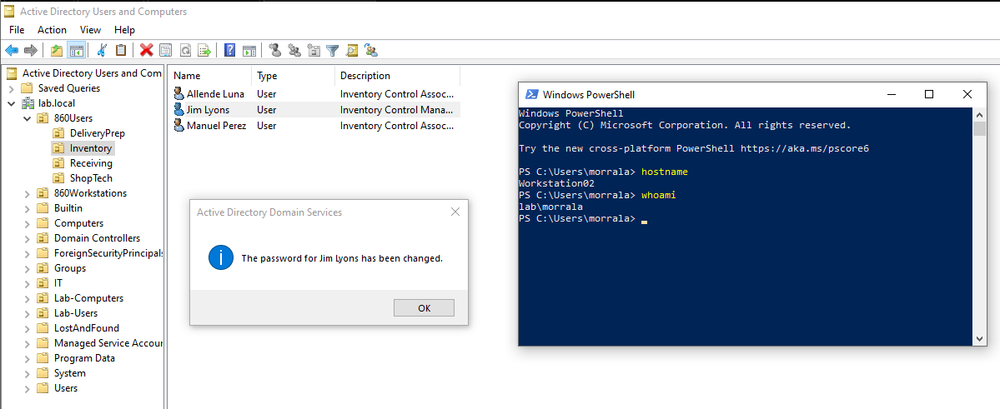

# Project 7 – Delegation of Control

## Overview

Implemented Delegation of Control in Active Directory to support least-privilege administration. Specific administrative tasks were delegated to a Helpdesk security group without granting Domain Administrator privileges.

The implementation demonstrates how routine user-management responsibilities can be assigned to support personnel while maintaining security boundaries and reducing administrative risk.

## Administrative Flow

```text
Helpdesk Technician → GG_Helpdesk → Delegated Permissions → Inventory OU (users) → Password Management
```

## Objectives

- Implement least-privilege administration.
- Reduce reliance on Domain Administrator accounts.
- Delegate routine administrative tasks.
- Restrict administrative permissions to a specific Organizational Unit.
- Simulate real-world Helpdesk access management.

## Implementation Highlights

- Created the Global Security Group `GG_Helpdesk` to represent Helpdesk personnel.
- Created a dedicated Helpdesk user account for Mike Orrala.
- Added the Helpdesk account to `GG_Helpdesk`.
- Applied Delegation of Control to the Inventory OU under `860Users`.
- Used the Delegation of Control Wizard to assign password management permissions to `GG_Helpdesk`.
- Delegated the ability to reset user passwords and require a password change at next logon.
- Maintained separation between delegated administration and Domain Administrator privileges.
- Used security group membership to manage assignment of delegated administrative permissions.

## Validation

Verified that:

- The Helpdesk account receives delegated permissions through membership in `GG_Helpdesk`.
- Helpdesk personnel can perform delegated password management tasks within the target OU.
- Delegated administration is scoped to the Inventory OU under `860Users`.
- Domain Administrator membership is not required to perform the delegated task.
- Delegated permissions are visible within the Inventory OU's Advanced Security settings.
- The Helpdesk account can successfully reset an Inventory user's password while operating under the delegated user context.

## Business Value

Delegation of Control enables organizations to distribute routine administrative responsibilities without expanding Domain Administrator access.

This approach supports:

- Least Privilege
- Separation of Duties
- Improved Security
- Reduced Administrative Risk
- Scalable Helpdesk Operations
- Role-Based Administration

By granting only the permissions required for assigned job functions, organizations can improve security while maintaining operational efficiency.

## Exhibits

### Exhibit 1: GG_Helpdesk Security Group Membership



`GG_Helpdesk` global security group showing Helpdesk technician Mike Orrala as a member, establishing group-based assignment of delegated administrative permissions.

### Exhibit 2: Delegate Control Wizard Target Selection



Delegation of Control Wizard showing `GG_Helpdesk` selected to receive delegated permissions for the Inventory OU.

### Exhibit 3: Selected Delegated Task Permissions



Delegation of Control Wizard showing the password reset and forced password-change task selected for delegation to `GG_Helpdesk`.

### Exhibit 4: Advanced Security Permissions on Inventory OU



Advanced Security settings for the Inventory OU showing `GG_Helpdesk` with delegated password-reset permissions applying to descendant user objects.

### Exhibit 5: Helpdesk Password Reset Execution and User Context Validation



Validation showing Helpdesk technician Mike Orrala (`lab\morrala`) successfully resetting an Inventory user's password through delegated permissions while operating from `Workstation02`.