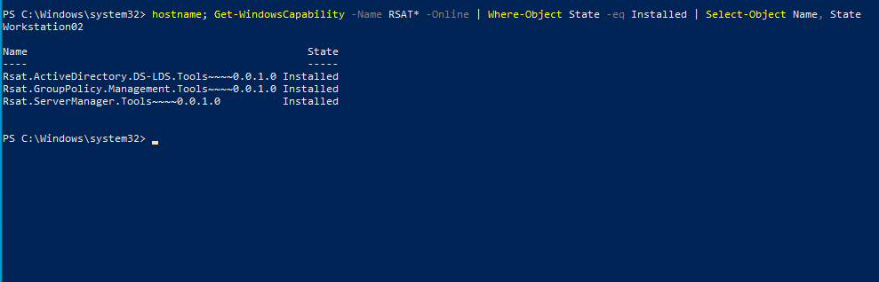
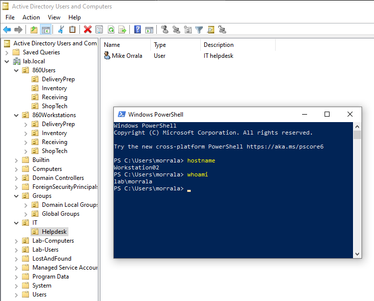
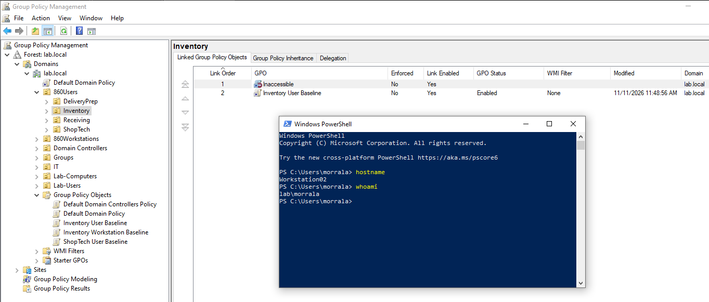
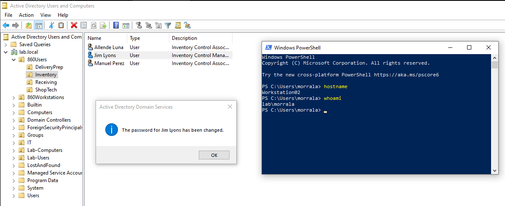

# Project 8 – RSAT Administration

## Overview

Implemented Remote Server Administration Tools (RSAT) on a domain-joined Windows 10 administration workstation to remotely manage Active Directory services without requiring direct logon to the Domain Controller.

This project demonstrates enterprise administration practices by separating day-to-day administrative activities from direct Domain Controller access while supporting both delegated and elevated administrative workflows.

## Administrative Workflow

```text
Workstation02 → RSAT → ADUC / GPMC → Domain Controller (DC01) → Active Directory
```

## Objectives

- Implement remote Active Directory administration.
- Reduce dependency on direct Domain Controller logins.
- Validate delegated administrative permissions.
- Simulate enterprise administration workflows.
- Support least-privilege administration.

## Implementation Highlights

- Temporarily connected `Workstation02` to the Internet using a NAT adapter to obtain the RSAT components.
- Installed `RSAT: Active Directory Domain Services and LDS Tools`.
- Installed `RSAT: Group Policy Management Tools`.
- Verified remote administration through Active Directory Users and Computers (ADUC) and Group Policy Management Console (GPMC).
- Used RSAT from `Workstation02` to perform Active Directory administrative tasks.
- Validated Helpdesk delegation using Mike Orrala (`lab\morrala`) without granting Domain Administrator privileges.
- Validated elevated administrative access through RSAT using separate administrative credentials without requiring direct logon to `DC01`.

## Validation

Verified that:

- Active Directory Users and Computers (ADUC) can be launched and used from `Workstation02`.
- Group Policy Management Console (GPMC) can be launched and used from `Workstation02`.
- Active Directory can be administered remotely through RSAT.
- Delegated Helpdesk permissions function through the remote administration workflow.
- Elevated administrative tasks can be performed remotely using appropriate administrative credentials.
- Direct Domain Controller logon is not required for the demonstrated administrative tasks.

## Business Value

RSAT enables administrators to manage Active Directory services from dedicated administration workstations while reducing direct interaction with Domain Controllers.

This approach supports:

- Least Privilege Administration
- Reduced Domain Controller Exposure
- Improved Security
- Separation of Duties
- Centralized Management
- Enterprise Administrative Practices

By performing routine administrative activities from a dedicated management workstation, organizations can maintain efficient access to administrative tools while reducing reliance on direct Domain Controller logons.

## Exhibits

### Exhibit 1: RSAT Optional Features Installed on Workstation02



RSAT components installed on `Workstation02`, enabling remote Active Directory and Group Policy administration.

### Exhibit 2: Remote ADUC Execution on Workstation02



Active Directory Users and Computers (`dsa.msc`) running on `Workstation02` under the Mike Orrala (`lab\morrala`) user context, demonstrating remote Active Directory administration through RSAT without direct logon to the Domain Controller.

### Exhibit 3: Remote GPMC Execution and Delegated Access Validation



Group Policy Management Console (`gpmc.msc`) running on `Workstation02` under the Mike Orrala (`lab\morrala`) user context, demonstrating remote Group Policy access and permission boundaries through RSAT.

### Exhibit 4: Delegated Helpdesk Administration via RSAT on Workstation02



Validation showing Helpdesk technician Mike Orrala (`lab\morrala`) performing delegated Active Directory administration through RSAT on `Workstation02`.

### Exhibit 5: Elevated Administration via RSAT on Workstation02

![Elevated Administration via RSAT](images/p8-strating credential separation and remote Active Directory administration without direct Domain Controller logon.     