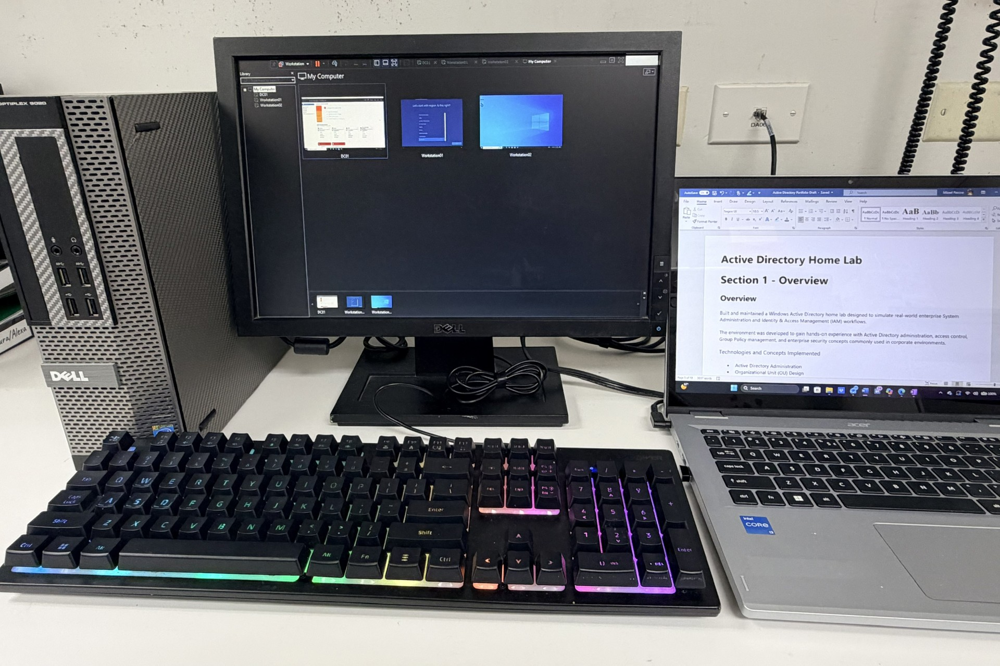

# Active Directory Home Lab

## Overview

This portfolio documents the design, implementation, administration, and validation of a Windows-based Active Directory home lab built to simulate a small enterprise environment. The lab was developed to gain hands-on experience with identity and access management, Group Policy administration, file services, delegation of control, and Role-Based Access Control (RBAC).

The environment consists of a Windows Server 2022 Domain Controller and Windows 10 client systems hosted in VMware Workstation. Throughout the lab, administrative solutions were implemented and validated using practices including Organizational Unit design, AGDLP, Group Policy, Security Filtering, Delegation of Control, and Remote Server Administration Tools (RSAT).

The portfolio contains eight projects demonstrating core Active Directory administration concepts, with implementation documentation, validation testing, and supporting exhibits collected from the lab environment.

## Lab Environment

This Active Directory lab was built to simulate a small enterprise environment using dedicated virtualization hardware and Windows-based infrastructure services.

### Hardware

**Virtualization Host**
- Dell OptiPlex 9020
- Intel Core i5-4590 @ 3.30 GHz
- 24 GB RAM
- 250 GB SSD

**Administration / Documentation System**
- Acer Aspire 3 Spin 14
- Used for documentation, administration, and portfolio development

### Virtualization Platform

- VMware Workstation Pro 26H1

### Domain Information

- **Active Directory Domain:** `lab.local`

### Lab Systems

**DC01**
- Windows Server 2022
- Active Directory Domain Services
- DNS Server
- DHCP Server
- File Services

**Workstation01**
- Windows 10 Pro
- Domain-joined client

**Workstation02**
- Windows 10 Pro
- Domain-joined client
- RSAT administration workstation

### Network Configuration

- **Virtual Network:** VMware Workstation Pro VMnet10
- **Network Address Space:** `10.1.10.0/24`
- **Active Directory Domain:** `lab.local`
- **DNS:** Hosted on `DC01`
- **DHCP:** Hosted on `DC01`
- **Clients:** Domain-joined Windows systems
- **Network Purpose:** Internal private lab network for Active Directory testing and administration

### Environment Overview

Dedicated Active Directory home lab hosted on a Dell OptiPlex 9020 running VMware Workstation, with Windows Server 2022 and Windows 10 virtual machines.



## Technologies Used

### Infrastructure Services

- Active Directory Domain Services (AD DS)
- Domain Name System (DNS)
- Dynamic Host Configuration Protocol (DHCP)
- Windows File Services

### Identity & Access Management

- Organizational Units (OUs)
- Security Groups
- AGDLP
- Role-Based Access Control (RBAC)
- Delegation of Control
- Least-Privilege Administration

### Group Policy

- Group Policy Objects (GPOs)
- Group Policy Preferences
- Security Filtering
- Group Policy Management Console (GPMC)

### Administration Tools

- Remote Server Administration Tools (RSAT)
- Active Directory Users and Computers (ADUC)
- Group Policy Management Console (GPMC)
- PowerShell

### Platforms

- Windows Server 2022
- Windows 10 Pro
- VMware Workstation Pro

## Skills Demonstrated

### Active Directory Administration

- User and computer account administration
- Organizational Unit (OU) design and management
- Security group management
- Active Directory structure planning

### Identity & Access Management (IAM)

- AGDLP implementation
- Role-Based Access Control (RBAC)
- Security group nesting
- Access provisioning and deprovisioning
- Least-privilege administration

### Group Policy Management

- Group Policy Object (GPO) creation and administration
- Group Policy Preferences
- Security Filtering
- Policy inheritance and precedence
- Department-specific policy deployment

### File Services & Permissions

- NTFS permissions
- Share permissions
- Departmental file share administration
- Access validation and troubleshooting
- Centralized resource management

### Administrative Delegation

- Delegation of Control
- Helpdesk role implementation
- Administrative permission scoping
- Separation of duties

### Remote Administration & Troubleshooting

- Remote Server Administration Tools (RSAT)
- Remote Active Directory administration
- Group Policy validation and basic troubleshooting
- Access validation testing
- Delegated and elevated administrative workflows

## Projects Completed

### [Project 1: OU Design & Domain Structure](Project01/Project01-OU-Design.md)

Designed a departmental Active Directory hierarchy separating users, workstations, groups, and administrative functions to support GPO scoping, RBAC, and delegated administration.

### [Project 2: AGDLP Access Model](Project02/Project02-AGDLP.md)

Implemented the AGDLP model to manage Inventory department resource access through Global and Domain Local security groups rather than direct user permissions.

### [Project 3: Department File Share](Project03/Project03-Department-File-Share.md)

Created and secured an Inventory department file share using NTFS and share permissions, with authorized and unauthorized access validation.

### [Project 4: Drive Mapping via Group Policy](Project04/Project04-Drive-Mapping-via-GPO.md)

Automated deployment of the Inventory `I:` drive through Group Policy Preferences using OU-based targeting.

### [Project 5: Group Policy Administration](Project05/Project05-Group-Policy-Administration.md)

Created and managed user and workstation baseline GPOs to centrally enforce department-specific Windows configurations.

### [Project 6: Security Filtering & Manager Exemptions](Project06/Project06-Security-Filtering-and-Manager-Exemptions.md)

Implemented Security Filtering and GPO precedence to provide manager-specific policy exceptions without creating additional OUs.

### [Project 7: Delegation of Control](Project07/Project07-Delegation-of-Control.md)

Delegated password-management responsibilities to a Helpdesk security group while maintaining least-privilege administrative boundaries.

### [Project 8: RSAT Administration](Project08/Project08-RSAT-Administration.md)

Implemented RSAT on a domain-joined workstation to perform remote Active Directory and Group Policy administration without requiring routine direct logon to the Domain Controller.

## Repository Structure

```text

Active-Directory-Home-Lab/

├── README.md

├── lab-setup.jpg

├── Project01/

├── Project02/

├── Project03/

├── Project04/

├── Project05/

├── Project06/

├── Project07/

└── Project08/

```

Each project directory contains the project documentation and supporting screenshots used to demonstrate implementation and validation.

## Future Roadmap

This lab will continue to evolve as additional Windows infrastructure and identity-management technologies are implemented and documented.

Planned areas of development include:

- Active Directory DNS administration
- Windows Server DHCP administration
- Advanced Group Policy troubleshooting
- Microsoft LAPS
- Microsoft Entra ID administration
- Hybrid identity